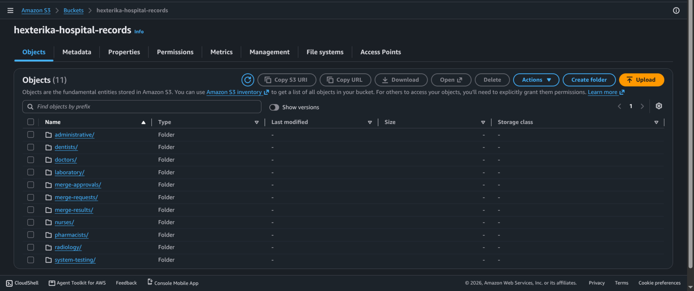

# Part 1 — Hospital Access Requirements and AWS Resource Model

[Back to lab overview](./fictional-hospital.md)

## Hospital Access Requirements

This section explains the hospital only as far as needed to make IAM decisions. It is not a complete hospital operating model.

### Simplified Patient-Record Areas

- Administrative patient information
- Doctors' records
- Nursing records
- Pharmacy records
- Dental records
- Laboratory records
- Radiology records
- Record-merge requests, approvals, and results

### Hospital Roles

| Role | Required access |
| ---- | --------------- |
| Patient registration | Create and maintain administrative patient information |
| Doctors | Read relevant patient information and maintain doctors' clinical records |
| Nurses | Read authorized clinical instructions and maintain nursing-treatment records |
| Pharmacists | Read prescriptions and maintain medication-dispensing records |
| Dentists | Read patients' clinical data and maintain dental treatment records, including findings used for forensic identification |
| Laboratory staff | Read laboratory orders and maintain laboratory results |
| Radiology staff | Read imaging orders and maintain radiology results |
| IT | Operate hospital technology without routine access to patient-record contents |
| External access | Receive temporary, engagement-specific access for administration, assessment, or audit |

Group names are prefixed `hexterika-`. Within that, `hospital-` is added where the role name is generic enough to recur in another organization, such as IT (`hexterika-hospital-it`). Role names specific to a hospital, such as doctors or pharmacists, carry no extra prefix.

## AWS Resource Model

This section identifies the minimum AWS resources used to make the IAM policies real. Resources start at zero. A resource is added only when a group duty cannot be expressed without it.

### Amazon S3 (+1)

One S3 bucket represents the hospital's simplified record storage.

```text
hexterika-hospital-records/
├── administrative/
├── doctors/
├── nurses/
├── pharmacists/
├── dentists/
├── laboratory/
├── radiology/
├── merge-requests/
├── merge-approvals/
├── merge-results/
└── system-testing/
```



#### S3 Prefix Functional Groups

| Area | Prefixes | Purpose | Used in |
| ---- | -------- | ------- | ------- |
| Patient departments (7) | `administrative/`, `doctors/`, `nurses/`, `pharmacists/`, `dentists/`, `laboratory/`, `radiology/` | Store fictional patient records by department | Phase 1 |
| Duplicate-record workflow (3) | `merge-requests/`, `merge-approvals/`, `merge-results/` | Separate duplicate reporting, approval, and merge results | Phase 2 |
| Technical testing (1) | `system-testing/` | Hold temporary objects for controlled IAM and S3 testing | Phase 3 |

These are S3 object-key prefixes, not real directories. S3 storage is flat: an object called `doctors/patient-001_doctors_diagnosis.json` is one key, and the console only displays the part before `/` as a folder. A prefix is not a permission boundary by itself. Access to a prefix exists only because an IAM policy names it.

### Patient-Record Organization

The bucket uses a department-first key structure. Each department's records live under that department's prefix, and records belonging to the same patient share a manually assigned identifier such as `patient-001`.

Key format: `<department>/<patient-id>_<department>_<record-type>.json`

```text
administrative/patient-001_administrative_registration.json
doctors/patient-001_doctors_diagnosis.json
nurses/patient-001_nurses_observation.json
pharmacists/patient-001_pharmacists_medication.json
dentists/patient-001_dentists_dental-exam.json
laboratory/patient-001_laboratory_blood-test.json
radiology/patient-001_radiology_xray-report.json
```

The sample records are in [`hexterika-patient-record-files/`](./hexterika-patient-record-files/).

#### Why department-first

> **WRITE IN YOUR OWN WORDS:** Why are the keys organized department first (`doctors/patient-001_...`) instead of patient first (`patient-001/doctors/...`)? Think about how each choice looks in a policy `Resource` line and how easy it is to test.
>
> Length: one or two short paragraphs.

#### Patient identity and relationships

> **REVIEW:** Check this matches your understanding of what S3 does and does not enforce.

The shared patient identifier is a naming convention, not an enforced relationship. S3 does not link these objects, does not check that patient identifiers match, and does not require an administrative record to exist before a clinical record is created. A doctor with write access to `doctors/` can write a record for a patient ID that does not exist.

In a real hospital system, an application or database manages patient identities, validates references between records, and enforces data-integrity rules. This lab does not include a relational database, a record-linking application, or automated referential-integrity checks. It is an AWS IAM and access-control lab, not an electronic health record application.

### AWS Lambda (+1, Phase 2)

One Lambda function will handle the outcome of a merge decision. It is part of the duplicate-record workflow and is not built in Phase 1. See [Part 4](./part-4-planned-phases.md).

### Resource Count

| Resource | Required by | Running total | Status |
| -------- | ----------- | ------------- | ------ |
| S3 bucket | All record-handling groups | 1 | Built |
| Lambda merge function | `hexterika-duplicate-record-merge-operators` | 2 | Planned (Phase 2) |

Services not added: CloudTrail, Config, Security Hub, and KMS. Activity logging and security monitoring are account-wide and belong to `gexter-boss` under Walkthrough 01. Encryption management is not required by any hospital group duty.
