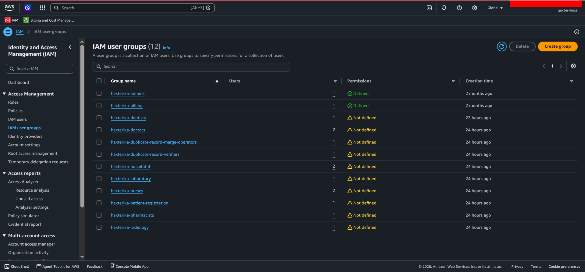
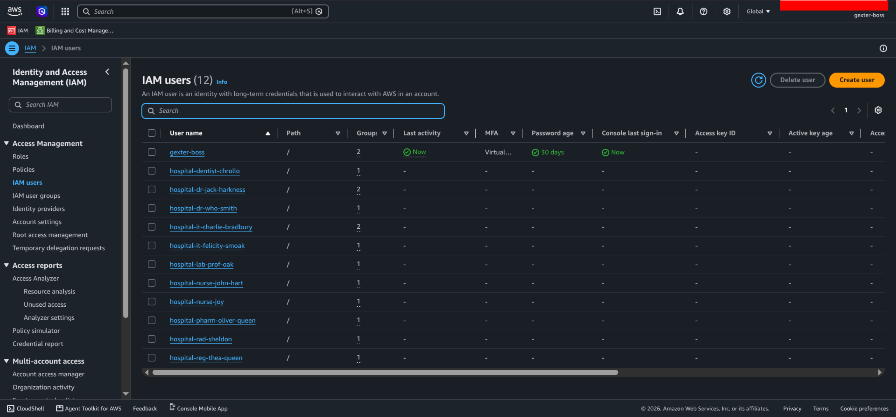

# Part 2 — IAM Groups and Users

[Back to lab overview](./fictional-hospital.md)

This part lists the seven department groups that hold permissions in Phase 1, the hospital tasks each group performs, and the business reason behind each permission. The policy documents and tests are in [Part 3](./part-3-phase-1-implementation-and-testing.md). The duplicate-record and hospital IT groups are in [Part 4](./part-4-planned-phases.md).

## Phase 1 Department Groups

| Group | Policy | Reads | Writes |
| ----- | ------ | ----- | ------ |
| `hexterika-doctors` | `HexterikaHospital-Doctors-S3Access` | Six clinical prefixes | `doctors/` |
| `hexterika-nurses` | `HexterikaHospital-Nurses-S3Access` | Six clinical prefixes | `nurses/` |
| `hexterika-pharmacists` | `HexterikaHospital-Pharmacists-S3Access` | Six clinical prefixes | `pharmacists/` |
| `hexterika-dentists` | `HexterikaHospital-Dentists-S3Access` | Six clinical prefixes | `dentists/` |
| `hexterika-laboratory` | `HexterikaHospital-Laboratory-S3Access` | Six clinical prefixes | `laboratory/` |
| `hexterika-radiology` | `HexterikaHospital-Radiology-S3Access` | Six clinical prefixes | `radiology/` |
| `hexterika-patient-registration` | `HexterikaHospital-PatientRegistration-S3Access` | `administrative/` | `administrative/` |

The six clinical prefixes are `doctors/`, `nurses/`, `pharmacists/`, `dentists/`, `laboratory/`, and `radiology/`. No group can delete objects in Phase 1.

### hexterika-patient-registration

This group allows patient-registration staff to create and maintain patient identity, demographic, and contact records, including temporary profiles for unidentified patients. The group has no clinical-data access.

| Hospital task | Business justification |
| ------------- | ---------------------- |
| Create a patient profile | Create a new patient registration record so clinical information can be associated with the correct patient identity. |
| Read administrative records | Access patient identity, demographic, and contact information required for registration and duplicate detection. |
| Update administrative records | Maintain patient identity, demographic, and contact information. |
| Create an unidentified patient profile | Register an unidentified patient using a temporary identity. The same record structure is kept so identity information can be updated or reconciled later, and the duplicate-record workflow handles the merge. |
| No clinical-data access | Registration staff cannot read or modify patient clinical information. |

Reporting suspected duplicates is part of the Phase 2 duplicate-record workflow.

### hexterika-doctors

This grants doctors access to add their diagnosis to each patient's records. It is different from the nurses group because a nurse records check-up information but does not diagnose the patient at the level a doctor does. Only a licensed doctor writes the diagnosis, rather than anyone who works at the hospital being able to write everything about a patient.

| Hospital task | Business justification |
| ------------- | ---------------------- |
| Read all clinical records of a patient, but not the administrative record | A doctor's task is to treat the patient. They are not responsible for the administrative part, and keeping it out of view prevents doctor-patient bias from the administrative profile. |
| Write to the doctors' records only | A doctor reads all clinical data but writes only the doctors' diagnosis records. This supports separation of duties, because a doctor and a pharmacist specialize in different areas, and it helps make sure patients get a high standard of treatment. |

### hexterika-nurses

This grants nurses access to record that they gave treatment X to patient Y at time Z. For example, Nurse Joy records that she took Ash Ketchup's body temperature and blood pressure and gave him a morphine injection ordered by Doctor Who Smith at 10:30 AM on August 1, 2026. Nurse Joy is not allowed to diagnose Ash Ketchup. She reads Doctor Who Smith's diagnosis and order from the records and records her own work. This prevents Nurse Joy from giving Ash Ketchup a cyanide injection and getting away with it. For prescription drugs, Nurse Joy gets the medication from a pharmacist who reads Ash Ketchup's records. This protects the patient if the pharmacist hands over the wrong drug, and protects the pharmacist if they hand over the correct drug and it is switched later.

| Hospital task | Business justification |
| ------------- | ---------------------- |
| Read all clinical records of a patient, but not the administrative record | A nurse gives the patient treatment ordered by the doctor and medication supplied by the pharmacist. They are not responsible for the administrative part, and keeping it out of view prevents nurse-patient bias. |
| Write to the nurses' records only | The nurse's record is evidence of their work: when they checked on the patient, what medication or treatment they gave, and whether it matched what the doctor and the pharmacist ordered. If the nurse does everything correctly, the steps can be retraced to check whether the pharmacist or the doctor made an error. Each clinical professional has their own record of work, so mistakes can be traced and fixed in time. |

### hexterika-pharmacists

This grants pharmacists access to read the patient's records and record the medication they dispense. In this lab, everything is assumed to be typed into each record directly. In real-world practice, a QR code or barcode scan is recommended to keep a correct record of which medication was given, to which nurse, and at what time.

| Hospital task | Business justification |
| ------------- | ---------------------- |
| Read all clinical records of a patient, but not the administrative record | A pharmacist assigns suitable medication according to the doctor's diagnosis and hands the correct medication to the nurse for delivery. They are not responsible for the administrative part, and keeping it out of view prevents pharmacist-patient bias. |
| Write to the pharmacists' records only | The pharmacist decides suitable medication according to the doctor's diagnosis, checks whether the medication the doctor assigned is suitable, checks for medication allergies, and gives the correct drug to the nurse for an in-hospital patient or directly to the correct patient at the counter for an out-patient. |

### hexterika-dentists

This grants dentists permission to read the patient's clinical data and write dental treatment to the patient's records. Dental records also support forensic identification: when an unidentified body cannot be identified by other means, a dentist can compare its teeth against existing patients' dental records. The dentist records that comparison as a clinical finding. The decision to merge records stays with the duplicate-record verifiers in Phase 2.

| Hospital task | Business justification |
| ------------- | ---------------------- |
| Read all clinical records of a patient, but not the administrative record | Dental treatment depends on medical history, such as medications that affect bleeding or healing, and allergies. The same read access lets a dentist compare an unidentified body's teeth against existing patients' dental records when the body is too damaged to identify by other means. |
| Write to the dentists' records only | Dental treatment is recorded in the patient's records, including a forensic comparison finding written to an unidentified patient's profile. |

### hexterika-laboratory

> **REVIEW:** The earlier write-up said laboratory and radiology read only the doctor's order. The policy you built lets them read all six clinical prefixes, so the first row now describes the build. Decide which one you want.

This grants laboratory staff permission to write their results to the patient's records, such as blood test, urine test, and hormone test results.

| Hospital task | Business justification |
| ------------- | ---------------------- |
| Read clinical records, including the doctor's order | Laboratory staff need the doctor's order to perform the correct test on the patient's samples, such as urine or blood. This role has no need for administrative read access. |
| Write to the laboratory records only | Laboratory results are recorded to the patient's records. |

### hexterika-radiology

This grants radiology staff permission to read the doctor's imaging order and write the imaging result to the patient's records. It is kept separate from laboratory because the two produce different result types, and neither has a reason to write into the other's records.

| Hospital task | Business justification |
| ------------- | ---------------------- |
| Read clinical records, including the doctor's order | Radiology staff need the doctor's order to perform the correct imaging, such as a left-foot X-ray for a patient who fell off a horse, to confirm a broken foot. This role has no need for administrative read access. |
| Write to the radiology records only | Radiology results, such as an X-ray report, are recorded to the patient's records. |

## IAM Users and Group Membership

| IAM user | Fictional position | IAM group or groups |
| -------- | ------------------ | ------------------- |
| `hospital-reg-thea-queen` | Patient registration officer | `hexterika-patient-registration` |
| `hospital-dr-who-smith` | Attending doctor | `hexterika-doctors` |
| `hospital-dr-jack-harkness` | Attending doctor, ordinary merge verifier | `hexterika-doctors`, `hexterika-duplicate-record-verifiers` |
| `hospital-nurse-joy` | Ward nurse | `hexterika-nurses` |
| `hospital-nurse-john-hart` | Ward nurse | `hexterika-nurses` |
| `hospital-pharm-oliver-queen` | Pharmacist | `hexterika-pharmacists` |
| `hospital-dentist-chrollo` | Dentist | `hexterika-dentists` |
| `hospital-lab-prof-oak` | Laboratory technician | `hexterika-laboratory` |
| `hospital-rad-sheldon` | Radiology technician | `hexterika-radiology` |
| `hospital-it-felicity-smoak` | IT technician | `hexterika-hospital-it` |
| `hospital-it-charlie-bradbury` | IT technician, merge operator | `hexterika-hospital-it`, `hexterika-duplicate-record-merge-operators` |

Every user carries the `hospital-` prefix so the whole lab can be identified and deleted at the end without touching the account-wide identities.

All 10 hospital groups and all 11 hospital users are created. The group list below also shows `hexterika-admins` and `hexterika-billing`, which belong to the account-wide setup in Walkthrough 01. In Phase 1, only the seven department groups have a policy attached. `hexterika-duplicate-record-verifiers`, `hexterika-duplicate-record-merge-operators`, and `hexterika-hospital-it` exist with no permissions until Phases 2 and 3.

> **REVIEW:** Check both paragraphs below against your setup.

Hospital users have no console password and no access keys. They exist to hold group membership, and permissions are verified against the groups (see [Part 3](./part-3-phase-1-implementation-and-testing.md#test-method)).

