# Part 3 — Phase 1 Implementation and Testing

[Back to lab overview](./fictional-hospital.md)

Phase 1 covers department-level access to patient records: which hospital group can read, write, list, and delete which part of the `hexterika-hospital-records` bucket. The duplicate-record workflow and hospital IT operations are outside Phase 1.

## Implementation

> **REVIEW:** Check the build steps match what you did, in the order you did them.

1. Created the `hexterika-hospital-records` bucket with its 11 prefixes and uploaded one fictional record per department for `patient-001` (see [Part 1](./part-1-access-requirements-and-resource-model.md)).
2. Created the 10 hospital groups and 11 hospital users, and assigned group membership (see [Part 2](./part-2-iam-groups-and-users.md)).
3. Created seven customer-managed IAM policies, one per department, and attached each one to its department group.
4. Ran 90 permission tests in the AWS IAM Policy Simulator against the seven department groups.

All resources, users, groups, and policies were created by `gexter-boss`.

### Policy Structure

> **REVIEW:** Only the doctors JSON came from your Notion. The other six files in `policies/` were rebuilt from the same pattern and your test results; compare each with the JSON tab in the console, especially the `Sid` on the write statement.

Every clinical department policy has the same three statements. Only the write prefix changes between departments.

| Sid | Action | Resource | What it allows |
| --- | ------ | -------- | -------------- |
| `ListClinicalRecords` | `s3:ListBucket` | Bucket ARN, with an `s3:prefix` condition naming the six clinical prefixes | See which object keys exist under the clinical prefixes |
| `ReadClinicalRecords` | `s3:GetObject` | Object ARNs for the six clinical prefixes | Open clinical records |
| `Write<Department>Records` | `s3:PutObject` | Object ARN for the department's own prefix | Create or overwrite records in the department's own prefix |

The patient registration policy has the same three statements, scoped to `administrative/` only.

The doctors policy as an example:

```json
{
    "Version": "2012-10-17",
    "Statement": [
        {
            "Sid": "ListClinicalRecords",
            "Effect": "Allow",
            "Action": "s3:ListBucket",
            "Resource": "arn:aws:s3:::hexterika-hospital-records",
            "Condition": {
                "StringLike": {
                    "s3:prefix": [
                        "doctors/*",
                        "nurses/*",
                        "pharmacists/*",
                        "dentists/*",
                        "laboratory/*",
                        "radiology/*"
                    ]
                }
            }
        },
        {
            "Sid": "ReadClinicalRecords",
            "Effect": "Allow",
            "Action": "s3:GetObject",
            "Resource": [
                "arn:aws:s3:::hexterika-hospital-records/doctors/*",
                "arn:aws:s3:::hexterika-hospital-records/nurses/*",
                "arn:aws:s3:::hexterika-hospital-records/pharmacists/*",
                "arn:aws:s3:::hexterika-hospital-records/dentists/*",
                "arn:aws:s3:::hexterika-hospital-records/laboratory/*",
                "arn:aws:s3:::hexterika-hospital-records/radiology/*"
            ]
        },
        {
            "Sid": "WriteDoctorRecords",
            "Effect": "Allow",
            "Action": "s3:PutObject",
            "Resource": "arn:aws:s3:::hexterika-hospital-records/doctors/*"
        }
    ]
}
```

All seven policy documents are in [`policies/`](./policies/).

## How the Phase 1 Permissions Work

### Cross-department read, own-department write

Each clinical group specializes in a different area of treatment. A doctor diagnoses a patient. A nurse treats the patient according to the doctor's diagnosis. This includes taking the patient's temperature and giving medication according to the pharmacist's and the doctor's orders. A pharmacist needs the doctor's diagnosis to give the correct medication, as well as information about the patient's allergies to certain medications. Laboratory staff and radiology staff need the doctor's order for each patient to run a specific test on that patient. A dentist needs access to the patient's records to see if the patient is allergic to any medication or has taken any medication that would make bleeding difficult to stop. This is important because dental treatment sometimes causes small cuts or bleeding, such as when a dentist has to pull a tooth out. Having the ability to read all of the patient's clinical data is crucial, even across departments. Sometimes a dentist also needs an X-ray of the patient's teeth, which is why dentists can read radiology records. These are the reasons why all clinical staff can read all clinical data, even across departments.

When it comes to writing, however, each department only has permission to write to its own department's records. This supports the idea of separation of duties and respects that each clinical department specializes in a different area of treatment. This has various purposes. The first purpose is that each clinical department's staff can read their own previous records later. They have to write them in the present so that their future selves, or other staff in their department, can read each patient's past records.

Having no permission to write across departments means staff cannot overwrite other departments' records. This prevents records from being falsified and protects the integrity of the data, because only the department that should be able to write to a file can write to it. This protects both the department staff and the patient. Here is an example scenario:

Doctor Who Smith is able to write his diagnosis of patient Ash Ketchup. Nurse Joy cannot write Ash Ketchup's diagnosis because Nurse Joy isn't a doctor. This protects Ash Ketchup from getting the wrong treatment from a person who isn't qualified. You may be wondering why Nurse Joy needs write permission at all if she is a nurse. The reason is that Nurse Joy logs her treatment of Ash Ketchup, such as giving Ash Ketchup 2 paracetamol tablets at 2 AM on September 17, 2026. Nurse Joy did this within her role and clinical ability, because Ash Ketchup asked for them and the pharmacist allows it. In this case, the pharmacist's record said to give Ash Ketchup 2 tablets of paracetamol every 6 hours, and it is now 2 AM. The one who gives the medication to Ash Ketchup is Nurse Joy. Suppose Nurse Joy gave Ash Ketchup ibuprofen instead, either by honest mistake or on purpose, and Ash Ketchup turns out to be severely allergic to ibuprofen and dies. When the forensic team finds that the cause of death was an ibuprofen allergy, the forensic or legal staff can dig into the records and see that Nurse Joy made the mistake. This protects the pharmacist and the doctor. If the facts change, and the record says Ash Ketchup should take paracetamol but the pharmacist gives the wrong pill, the pharmacists' record shows what was dispensed and by which pharmacist. Nurse Joy can even record that she got the pills from Pharmacist Oliver Queen. This means the forensic team can check whether the pharmacist or the nurse made the mistake, or whether anyone intended to harm the patient. The same goes for the other clinical departments.

> ⚠️ **Note:** The records name Nurse Joy only because she enters her own staff ID in them. The same applies to the pharmacist. IAM only shows that the nurses' group was allowed to write the file, not which nurse wrote it. Proving which IAM user actually wrote a file would need S3 data-event logging in AWS CloudTrail, which is account-wide, belongs to `gexter-boss`, and is not part of this lab.

### Administrative access restrictions

The reason no clinical group can read a patient's administrative data is to protect the patient from bias and discrimination by clinical staff, and to protect the patient's sensitive information, such as their home address and government-issued ID number. It also prevents clinical staff from misusing the patient's information. For example, if the patient is a relative of the celebrity Damon and has Damon's number as an emergency contact, this prevents clinical staff who love or hate Damon from getting his number and harassing him, or from withholding treatment in exchange for meeting Damon.

A patient registration staff member should not harass Damon through Ash Ketchup either. However, patient registration staff are not clinical staff, so they cannot withhold Ash Ketchup's treatment. If a patient registration staff member abuses the data and takes Damon's phone number without his consent to harass him, the forensic team or the police can investigate. Because clinical staff cannot read administrative records, they are ruled out, which narrows the search down to patient registration staff and the account administrator.

Also, since patient registration staff cannot give clinical treatment, they should not be able to read Ash Ketchup's clinical data. This prevents them from reading or browsing Ash Ketchup's clinical data, such as an HIV test result, and using it to blackmail him. The point is that people who should not have access to something cannot access it. This also helps protect the patient.

In a real hospital, all of those permissions can be handled by an application. However, in this lab, I use the patient ID in each file name. In a hospital database, every record is linked to the patient ID assigned to each patient. A patient's name is optional, so staff can create a file for an unconscious patient without having to wait until he is conscious. The files can then be checked and merged later in Phase 2, which handles duplicate records.

In this lab, the patient ID is `patient-001`. Each record is stored as `[department]/patient-[3-digit ID]_[department]_[record name].json`.

Ex. `laboratory/patient-001_laboratory_hiv-test-result.json`

Clinical staff see the patient ID in the file name and inside the record, not the patient's name or contact details, so they know which patient a record belongs to without reading the administrative record.

### PutObject versus DeleteObject

> **WRITE IN YOUR OWN WORDS:** Why is `s3:PutObject` allowed while `s3:DeleteObject` is denied? What does `s3:PutObject` cover besides creating a new record, and why does denying delete not fully protect a record's content? Where does versioning fit in?
>
> Length: two or three short paragraphs.

### ListBucket restrictions

> **WRITE IN YOUR OWN WORDS:** Why do the object actions use object ARNs while `s3:ListBucket` uses the bucket ARN? What does the `s3:prefix` condition do, and what happens when a list request has no prefix or a prefix outside the allowed list?
>
> Length: two or three short paragraphs. A small table comparing the two ARN formats is fine.

### Implicit versus explicit deny

> **WRITE IN YOUR OWN WORDS:** In what order does AWS evaluate Allow, explicit Deny, and the default? Which kind of deny produced the 39 denied results? Why do the Phase 1 policies use no explicit Deny statements, and what would an explicit Deny on `administrative/*` do to the Phase 2 verifier access?
>
> Length: two or three short paragraphs. The evaluation order can be a numbered list.

### Phase 1 resource model

> **REVIEW:** Check this short summary still fits once you have written the department-first section in Part 1.

The department-first prefixes and the reasons for them are in [Part 1](./part-1-access-requirements-and-resource-model.md#why-department-first). S3 does not enforce relationships between one patient's records. The access boundaries in Phase 1 are department-level: they control which department's records a group can reach, not which patient.

## Test Method

All 90 tests were run in the AWS IAM Policy Simulator, with an IAM group selected as the identity and that group's attached policy as the only identity-based policy.

> **WRITE IN YOUR OWN WORDS:** What do the Policy Simulator results prove, and what do they not prove? Cover real S3 requests, group versus individual user permissions (including users in two groups), and bucket-side settings. Why were no live requests made as hospital users?
>
> Length: a short list for "shows" and a short list for "does not show", plus one or two sentences.

Test records use the key pattern `<department>/p1-test-<department>-record.json` for `PutObject` and `DeleteObject` tests. Read tests use the sample `patient-001` records, except the pharmacists' read tests, which use the prefix wildcard ARN.

## Permission Tests

Each department has two implementation screenshots (`P1-S##`) showing the policy and its attachment, followed by its permission tests (`P1-T##`). Each Evidence link opens that test's simulator screenshot.

### Doctors — P1-T01 to P1-T13

- Test identity: `hexterika-doctors` (IAM group)
- Policy: [`HexterikaHospital-Doctors-S3Access`](./policies/HexterikaHospital-Doctors-S3Access.json)

P1-S01 — Doctors policy created; permissions summary

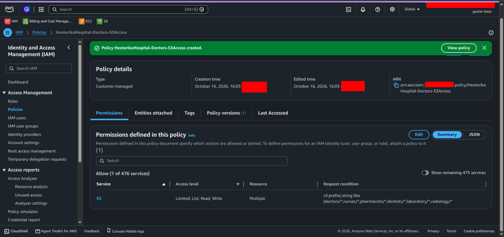

P1-S02 — Policy attached to `hexterika-doctors`

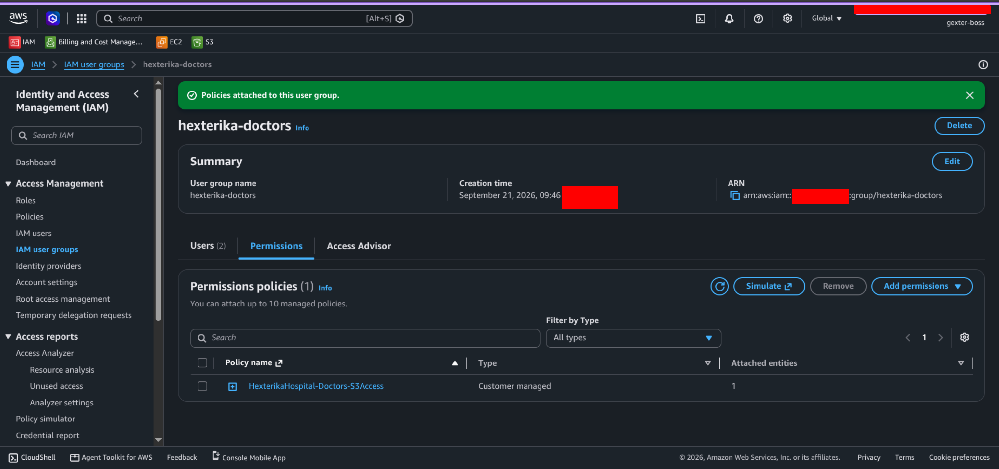

| Test ID | Action and purpose | Resource ARN | Expected | Actual result | Evidence |
| ------- | ------------------ | ------------ | -------- | ------------- | -------- |
| P1-T01 | `s3:GetObject` — Doctors' record | `arn:aws:s3:::hexterika-hospital-records/doctors/patient-001_doctors_diagnosis.json` | Allow | Allowed — PASS | [P1-T01.png](./images/P1-doctors/P1-T01.png) |
| P1-T02 | `s3:GetObject` — Nurses' record | `arn:aws:s3:::hexterika-hospital-records/nurses/patient-001_nurses_observation.json` | Allow | Allowed — PASS | [P1-T02.png](./images/P1-doctors/P1-T02.png) |
| P1-T03 | `s3:GetObject` — Pharmacists' record | `arn:aws:s3:::hexterika-hospital-records/pharmacists/patient-001_pharmacists_medication.json` | Allow | Allowed — PASS | [P1-T03.png](./images/P1-doctors/P1-T03.png) |
| P1-T04 | `s3:GetObject` — Dentists' record | `arn:aws:s3:::hexterika-hospital-records/dentists/patient-001_dentists_dental-exam.json` | Allow | Allowed — PASS | [P1-T04.png](./images/P1-doctors/P1-T04.png) |
| P1-T05 | `s3:GetObject` — Laboratory record | `arn:aws:s3:::hexterika-hospital-records/laboratory/patient-001_laboratory_blood-test.json` | Allow | Allowed — PASS | [P1-T05.png](./images/P1-doctors/P1-T05.png) |
| P1-T06 | `s3:GetObject` — Radiology record | `arn:aws:s3:::hexterika-hospital-records/radiology/patient-001_radiology_xray-report.json` | Allow | Allowed — PASS | [P1-T06.png](./images/P1-doctors/P1-T06.png) |
| P1-T07 | `s3:GetObject` — Administrative record | `arn:aws:s3:::hexterika-hospital-records/administrative/patient-001_administrative_registration.json` | Deny | Denied — PASS | [P1-T07.png](./images/P1-doctors/P1-T07.png) |
| P1-T08 | `s3:PutObject` — Create or overwrite doctors' test record | `arn:aws:s3:::hexterika-hospital-records/doctors/p1-test-doctor-record.json` | Allow | Allowed — PASS | [P1-T08.png](./images/P1-doctors/P1-T08.png) |
| P1-T09 | `s3:PutObject` — Write to nurses' records | `arn:aws:s3:::hexterika-hospital-records/nurses/p1-test-doctor-record.json` | Deny | Denied — PASS | [P1-T09.png](./images/P1-doctors/P1-T09.png) |
| P1-T10 | `s3:PutObject` — Write to administrative records | `arn:aws:s3:::hexterika-hospital-records/administrative/p1-test-doctor-record.json` | Deny | Denied — PASS | [P1-T10.png](./images/P1-doctors/P1-T10.png) |
| P1-T11 | `s3:DeleteObject` — Delete doctors' test record | `arn:aws:s3:::hexterika-hospital-records/doctors/p1-test-doctor-record.json` | Deny | Denied — PASS | [P1-T11.png](./images/P1-doctors/P1-T11.png) |
| P1-T12 | `s3:ListBucket` — Doctors' prefix (request context `s3:prefix` = `doctors/*`) | `arn:aws:s3:::hexterika-hospital-records` | Allow | Allowed — PASS | [P1-T12.png](./images/P1-doctors/P1-T12.png) |
| P1-T13 | `s3:ListBucket` — Administrative prefix (request context `s3:prefix` = `administrative/*`) | `arn:aws:s3:::hexterika-hospital-records` | Deny | Denied — PASS | [P1-T13.png](./images/P1-doctors/P1-T13.png) |

### Nurses — P1-T14 to P1-T26

- Test identity: `hexterika-nurses` (IAM group)
- Policy: [`HexterikaHospital-Nurses-S3Access`](./policies/HexterikaHospital-Nurses-S3Access.json)

P1-S03 — Nurses policy created; permissions summary

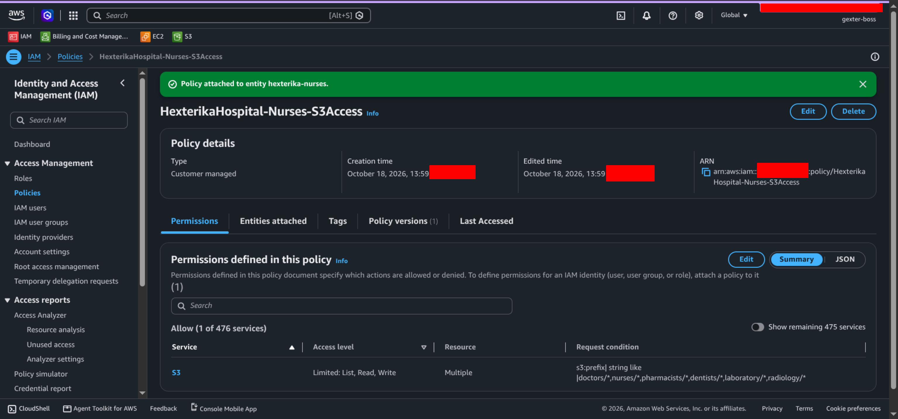

P1-S04 — Policy attached to `hexterika-nurses`

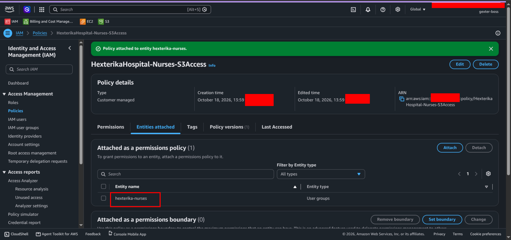

| Test ID | Action and purpose | Resource ARN | Expected | Actual result | Evidence |
| ------- | ------------------ | ------------ | -------- | ------------- | -------- |
| P1-T14 | `s3:GetObject` — Doctors' record | `arn:aws:s3:::hexterika-hospital-records/doctors/patient-001_doctors_diagnosis.json` | Allow | Allowed — PASS | [P1-T14.png](./images/P1-nurses/P1-T14.png) |
| P1-T15 | `s3:GetObject` — Nurses' record | `arn:aws:s3:::hexterika-hospital-records/nurses/patient-001_nurses_observation.json` | Allow | Allowed — PASS | [P1-T15.png](./images/P1-nurses/P1-T15.png) |
| P1-T16 | `s3:GetObject` — Pharmacists' record | `arn:aws:s3:::hexterika-hospital-records/pharmacists/patient-001_pharmacists_medication.json` | Allow | Allowed — PASS | [P1-T16.png](./images/P1-nurses/P1-T16.png) |
| P1-T17 | `s3:GetObject` — Dentists' record | `arn:aws:s3:::hexterika-hospital-records/dentists/patient-001_dentists_dental-exam.json` | Allow | Allowed — PASS | [P1-T17.png](./images/P1-nurses/P1-T17.png) |
| P1-T18 | `s3:GetObject` — Laboratory record | `arn:aws:s3:::hexterika-hospital-records/laboratory/patient-001_laboratory_blood-test.json` | Allow | Allowed — PASS | [P1-T18.png](./images/P1-nurses/P1-T18.png) |
| P1-T19 | `s3:GetObject` — Radiology record | `arn:aws:s3:::hexterika-hospital-records/radiology/patient-001_radiology_xray-report.json` | Allow | Allowed — PASS | [P1-T19.png](./images/P1-nurses/P1-T19.png) |
| P1-T20 | `s3:GetObject` — Administrative record | `arn:aws:s3:::hexterika-hospital-records/administrative/patient-001_administrative_registration.json` | Deny | Denied — PASS | [P1-T20.png](./images/P1-nurses/P1-T20.png) |
| P1-T21 | `s3:PutObject` — Create or overwrite nurses' test record | `arn:aws:s3:::hexterika-hospital-records/nurses/p1-test-nurse-record.json` | Allow | Allowed — PASS | [P1-T21.png](./images/P1-nurses/P1-T21.png) |
| P1-T22 | `s3:PutObject` — Write to doctors' records | `arn:aws:s3:::hexterika-hospital-records/doctors/p1-test-nurse-record.json` | Deny | Denied — PASS | [P1-T22.png](./images/P1-nurses/P1-T22.png) |
| P1-T23 | `s3:PutObject` — Write to administrative records | `arn:aws:s3:::hexterika-hospital-records/administrative/p1-test-nurse-record.json` | Deny | Denied — PASS | [P1-T23.png](./images/P1-nurses/P1-T23.png) |
| P1-T24 | `s3:DeleteObject` — Delete nurses' test record | `arn:aws:s3:::hexterika-hospital-records/nurses/p1-test-nurse-record.json` | Deny | Denied — PASS | [P1-T24.png](./images/P1-nurses/P1-T24.png) |
| P1-T25 | `s3:ListBucket` — Nurses' prefix (request context `s3:prefix` = `nurses/*`) | `arn:aws:s3:::hexterika-hospital-records` | Allow | Allowed — PASS | [P1-T25.png](./images/P1-nurses/P1-T25.png) |
| P1-T26 | `s3:ListBucket` — Administrative prefix (request context `s3:prefix` = `administrative/*`) | `arn:aws:s3:::hexterika-hospital-records` | Deny | Denied — PASS | [P1-T26.png](./images/P1-nurses/P1-T26.png) |

### Pharmacists — P1-T27 to P1-T39

- Test identity: `hexterika-pharmacists` (IAM group)
- Policy: [`HexterikaHospital-Pharmacists-S3Access`](./policies/HexterikaHospital-Pharmacists-S3Access.json)

P1-S05 — Pharmacists policy created; permissions summary

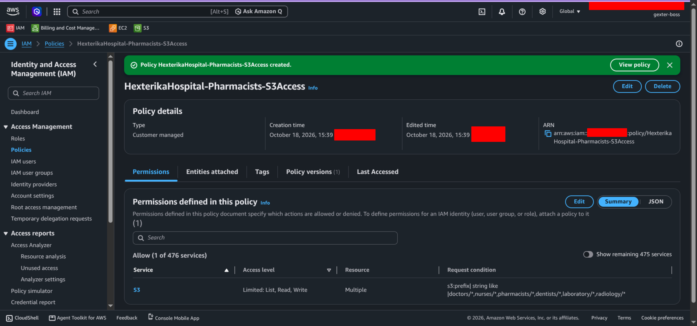

P1-S06 — Policy attached to `hexterika-pharmacists`

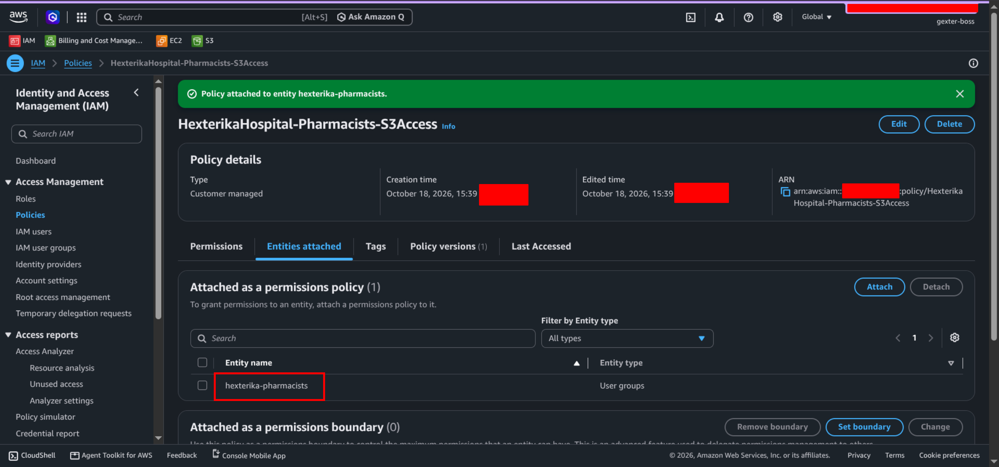

| Test ID | Action and purpose | Resource ARN | Expected | Actual result | Evidence |
| ------- | ------------------ | ------------ | -------- | ------------- | -------- |
| P1-T27 | `s3:GetObject` — Read doctors record | `arn:aws:s3:::hexterika-hospital-records/doctors/*` | Allow | Allowed — PASS | [P1-T27.png](./images/P1-pharmacists/P1-T27.png) |
| P1-T28 | `s3:GetObject` — Read nurses record | `arn:aws:s3:::hexterika-hospital-records/nurses/*` | Allow | Allowed — PASS | [P1-T28.png](./images/P1-pharmacists/P1-T28.png) |
| P1-T29 | `s3:GetObject` — Read pharmacists record | `arn:aws:s3:::hexterika-hospital-records/pharmacists/*` | Allow | Allowed — PASS | [P1-T29.png](./images/P1-pharmacists/P1-T29.png) |
| P1-T30 | `s3:GetObject` — Read dentists record | `arn:aws:s3:::hexterika-hospital-records/dentists/*` | Allow | Allowed — PASS | [P1-T30.png](./images/P1-pharmacists/P1-T30.png) |
| P1-T31 | `s3:GetObject` — Read laboratory record | `arn:aws:s3:::hexterika-hospital-records/laboratory/*` | Allow | Allowed — PASS | [P1-T31.png](./images/P1-pharmacists/P1-T31.png) |
| P1-T32 | `s3:GetObject` — Read radiology record | `arn:aws:s3:::hexterika-hospital-records/radiology/*` | Allow | Allowed — PASS | [P1-T32.png](./images/P1-pharmacists/P1-T32.png) |
| P1-T33 | `s3:GetObject` — Read administrative record | `arn:aws:s3:::hexterika-hospital-records/administrative/*` | Deny | Denied — PASS | [P1-T33.png](./images/P1-pharmacists/P1-T33.png) |
| P1-T34 | `s3:PutObject` — Create or overwrite pharmacists test record | `arn:aws:s3:::hexterika-hospital-records/pharmacists/p1-test-pharmacists.json` | Allow | Allowed — PASS | [P1-T34.png](./images/P1-pharmacists/P1-T34.png) |
| P1-T35 | `s3:PutObject` — Write to doctors record | `arn:aws:s3:::hexterika-hospital-records/doctors/p1-test-pharmacists.json` | Deny | Denied — PASS | [P1-T35.png](./images/P1-pharmacists/P1-T35.png) |
| P1-T36 | `s3:PutObject` — Write to administrative record | `arn:aws:s3:::hexterika-hospital-records/administrative/p1-test-pharmacists.json` | Deny | Denied — PASS | [P1-T36.png](./images/P1-pharmacists/P1-T36.png) |
| P1-T37 | `s3:DeleteObject` — Delete pharmacists test record | `arn:aws:s3:::hexterika-hospital-records/pharmacists/p1-test-pharmacists.json` | Deny | Denied — PASS | [P1-T37.png](./images/P1-pharmacists/P1-T37.png) |
| P1-T38 | `s3:ListBucket` — List pharmacists prefix (request context `s3:prefix` = `pharmacists/*`) | `arn:aws:s3:::hexterika-hospital-records` | Allow | Allowed — PASS | [P1-T38.png](./images/P1-pharmacists/P1-T38.png) |
| P1-T39 | `s3:ListBucket` — List administrative prefix (request context `s3:prefix` = `administrative/*`) | `arn:aws:s3:::hexterika-hospital-records` | Deny | Denied — PASS | [P1-T39.png](./images/P1-pharmacists/P1-T39.png) |

### Dentists — P1-T40 to P1-T52

- Test identity: `hexterika-dentists` (IAM group)
- Policy: [`HexterikaHospital-Dentists-S3Access`](./policies/HexterikaHospital-Dentists-S3Access.json)

P1-S07 — Dentists policy created; permissions summary

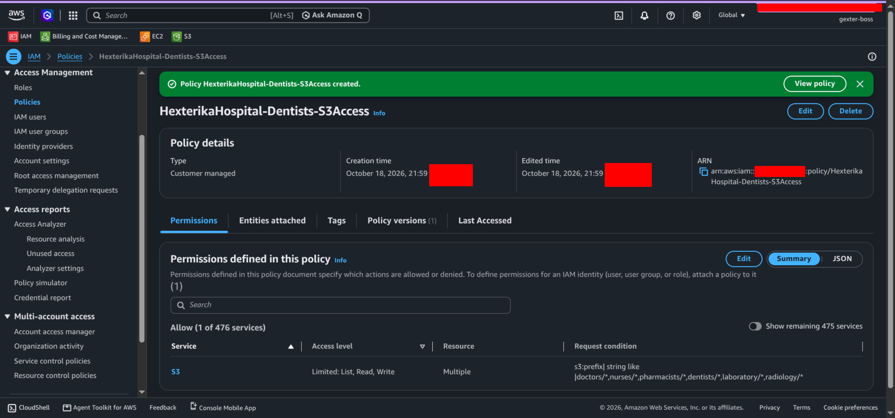

P1-S08 — Policy attached to `hexterika-dentists`

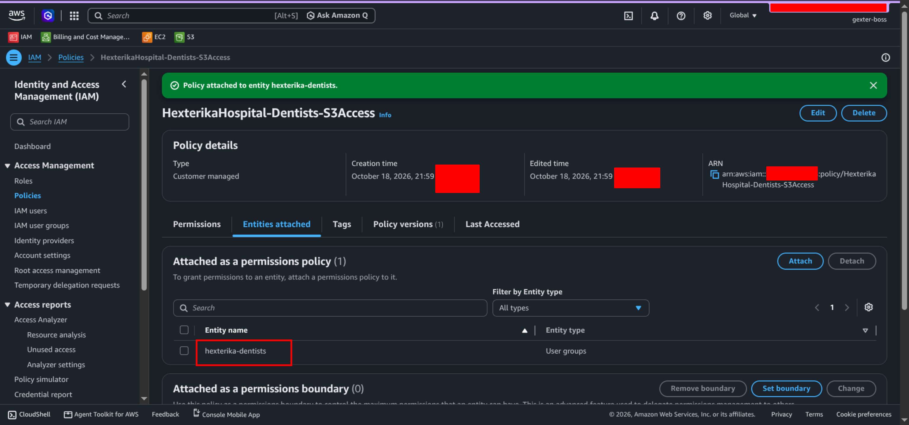

| Test ID | Action and purpose | Resource ARN | Expected | Actual result | Evidence |
| ------- | ------------------ | ------------ | -------- | ------------- | -------- |
| P1-T40 | `s3:GetObject` — Read doctors record | `arn:aws:s3:::hexterika-hospital-records/doctors/patient-001_doctors_diagnosis.json` | Allow | Allowed — PASS | [P1-T40.png](./images/P1-dentists/P1-T40.png) |
| P1-T41 | `s3:GetObject` — Read nurses record | `arn:aws:s3:::hexterika-hospital-records/nurses/patient-001_nurses_observation.json` | Allow | Allowed — PASS | [P1-T41.png](./images/P1-dentists/P1-T41.png) |
| P1-T42 | `s3:GetObject` — Read pharmacists record | `arn:aws:s3:::hexterika-hospital-records/pharmacists/patient-001_pharmacists_medication.json` | Allow | Allowed — PASS | [P1-T42.png](./images/P1-dentists/P1-T42.png) |
| P1-T43 | `s3:GetObject` — Read dentists record | `arn:aws:s3:::hexterika-hospital-records/dentists/patient-001_dentists_dental-exam.json` | Allow | Allowed — PASS | [P1-T43.png](./images/P1-dentists/P1-T43.png) |
| P1-T44 | `s3:GetObject` — Read laboratory record | `arn:aws:s3:::hexterika-hospital-records/laboratory/patient-001_laboratory_blood-test.json` | Allow | Allowed — PASS | [P1-T44.png](./images/P1-dentists/P1-T44.png) |
| P1-T45 | `s3:GetObject` — Read radiology record | `arn:aws:s3:::hexterika-hospital-records/radiology/patient-001_radiology_xray-report.json` | Allow | Allowed — PASS | [P1-T45.png](./images/P1-dentists/P1-T45.png) |
| P1-T46 | `s3:GetObject` — Read administrative record | `arn:aws:s3:::hexterika-hospital-records/administrative/patient-001_administrative_registration.json` | Deny | Denied — PASS | [P1-T46.png](./images/P1-dentists/P1-T46.png) |
| P1-T47 | `s3:PutObject` — Create or overwrite dentists test record | `arn:aws:s3:::hexterika-hospital-records/dentists/p1-test-dentist-record.json` | Allow | Allowed — PASS | [P1-T47.png](./images/P1-dentists/P1-T47.png) |
| P1-T48 | `s3:PutObject` — Write to doctors record | `arn:aws:s3:::hexterika-hospital-records/doctors/p1-test-dentist-record.json` | Deny | Denied — PASS | [P1-T48.png](./images/P1-dentists/P1-T48.png) |
| P1-T49 | `s3:PutObject` — Write to administrative record | `arn:aws:s3:::hexterika-hospital-records/administrative/p1-test-dentist-record.json` | Deny | Denied — PASS | [P1-T49.png](./images/P1-dentists/P1-T49.png) |
| P1-T50 | `s3:DeleteObject` — Delete dentists test record | `arn:aws:s3:::hexterika-hospital-records/dentists/p1-test-dentist-record.json` | Deny | Denied — PASS | [P1-T50.png](./images/P1-dentists/P1-T50.png) |
| P1-T51 | `s3:ListBucket` — List dentists prefix (request context `s3:prefix` = `dentists/*`) | `arn:aws:s3:::hexterika-hospital-records` | Allow | Allowed — PASS | [P1-T51.png](./images/P1-dentists/P1-T51.png) |
| P1-T52 | `s3:ListBucket` — List administrative prefix (request context `s3:prefix` = `administrative/*`) | `arn:aws:s3:::hexterika-hospital-records` | Deny | Denied — PASS | [P1-T52.png](./images/P1-dentists/P1-T52.png) |

### Laboratory — P1-T53 to P1-T65

- Test identity: `hexterika-laboratory` (IAM group)
- Policy: [`HexterikaHospital-Laboratory-S3Access`](./policies/HexterikaHospital-Laboratory-S3Access.json)

P1-S09 — Laboratory policy created; permissions summary

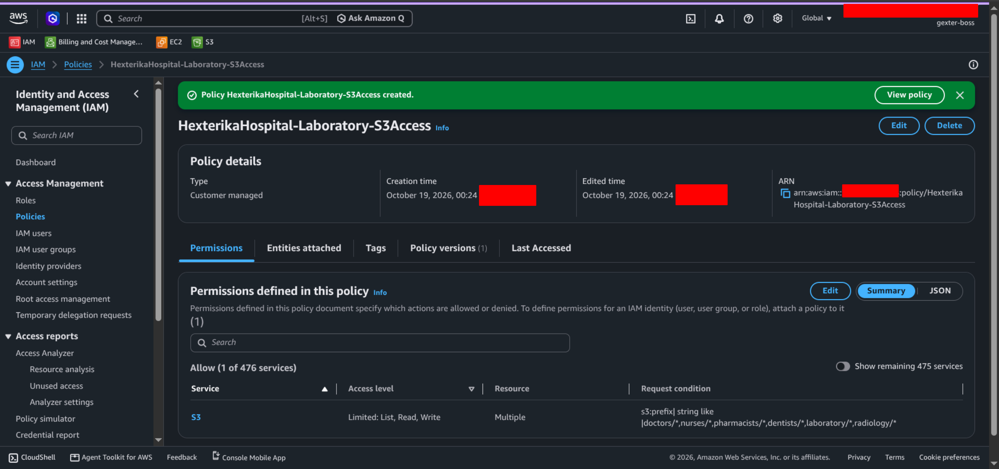

P1-S10 — Policy attached to `hexterika-laboratory`

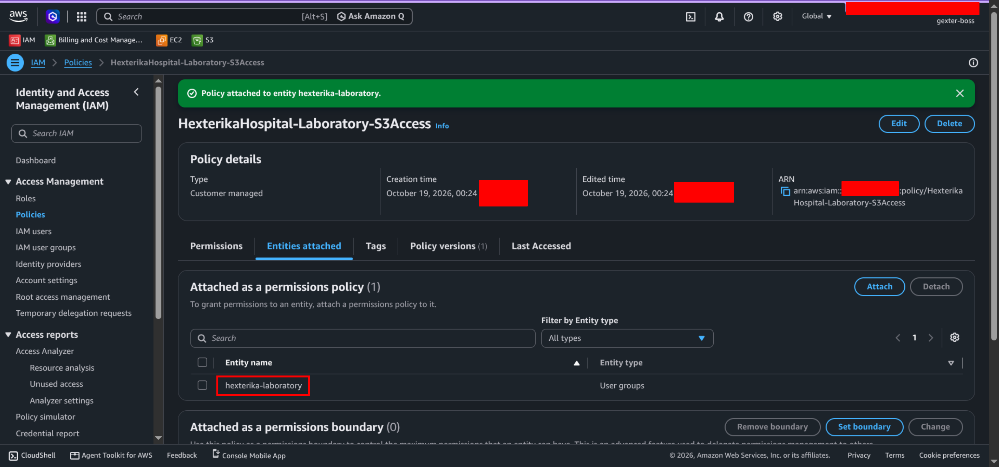

| Test ID | Action and purpose | Resource ARN | Expected | Actual result | Evidence |
| ------- | ------------------ | ------------ | -------- | ------------- | -------- |
| P1-T53 | `s3:GetObject` — Read doctors record | `arn:aws:s3:::hexterika-hospital-records/doctors/patient-001_doctors_diagnosis.json` | Allow | Allowed — PASS | [P1-T53.png](./images/P1-laboratory/P1-T53.png) |
| P1-T54 | `s3:GetObject` — Read nurses record | `arn:aws:s3:::hexterika-hospital-records/nurses/patient-001_nurses_observation.json` | Allow | Allowed — PASS | [P1-T54.png](./images/P1-laboratory/P1-T54.png) |
| P1-T55 | `s3:GetObject` — Read pharmacists record | `arn:aws:s3:::hexterika-hospital-records/pharmacists/patient-001_pharmacists_medication.json` | Allow | Allowed — PASS | [P1-T55.png](./images/P1-laboratory/P1-T55.png) |
| P1-T56 | `s3:GetObject` — Read dentists record | `arn:aws:s3:::hexterika-hospital-records/dentists/patient-001_dentists_dental-exam.json` | Allow | Allowed — PASS | [P1-T56.png](./images/P1-laboratory/P1-T56.png) |
| P1-T57 | `s3:GetObject` — Read laboratory record | `arn:aws:s3:::hexterika-hospital-records/laboratory/patient-001_laboratory_blood-test.json` | Allow | Allowed — PASS | [P1-T57.png](./images/P1-laboratory/P1-T57.png) |
| P1-T58 | `s3:GetObject` — Read radiology record | `arn:aws:s3:::hexterika-hospital-records/radiology/patient-001_radiology_xray-report.json` | Allow | Allowed — PASS | [P1-T58.png](./images/P1-laboratory/P1-T58.png) |
| P1-T59 | `s3:GetObject` — Read administrative record | `arn:aws:s3:::hexterika-hospital-records/administrative/patient-001_administrative_registration.json` | Deny | Denied — PASS | [P1-T59.png](./images/P1-laboratory/P1-T59.png) |
| P1-T60 | `s3:PutObject` — Create or overwrite laboratory test record | `arn:aws:s3:::hexterika-hospital-records/laboratory/p1-test-laboratory-record.json` | Allow | Allowed — PASS | [P1-T60.png](./images/P1-laboratory/P1-T60.png) |
| P1-T61 | `s3:PutObject` — Write to doctors records | `arn:aws:s3:::hexterika-hospital-records/doctors/p1-test-laboratory-record.json` | Deny | Denied — PASS | [P1-T61.png](./images/P1-laboratory/P1-T61.png) |
| P1-T62 | `s3:PutObject` — Write to administrative records | `arn:aws:s3:::hexterika-hospital-records/administrative/p1-test-laboratory-record.json` | Deny | Denied — PASS | [P1-T62.png](./images/P1-laboratory/P1-T62.png) |
| P1-T63 | `s3:DeleteObject` — Delete laboratory test record | `arn:aws:s3:::hexterika-hospital-records/laboratory/p1-test-laboratory-record.json` | Deny | Denied — PASS | [P1-T63.png](./images/P1-laboratory/P1-T63.png) |
| P1-T64 | `s3:ListBucket` — List laboratory prefix (request context `s3:prefix` = `laboratory/*`) | `arn:aws:s3:::hexterika-hospital-records` | Allow | Allowed — PASS | [P1-T64.png](./images/P1-laboratory/P1-T64.png) |
| P1-T65 | `s3:ListBucket` — List administrative prefix (request context `s3:prefix` = `administrative/*`) | `arn:aws:s3:::hexterika-hospital-records` | Deny | Denied — PASS | [P1-T65.png](./images/P1-laboratory/P1-T65.png) |

### Radiology — P1-T66 to P1-T78

- Test identity: `hexterika-radiology` (IAM group)
- Policy: [`HexterikaHospital-Radiology-S3Access`](./policies/HexterikaHospital-Radiology-S3Access.json)

P1-S11 — Radiology policy created; permissions summary

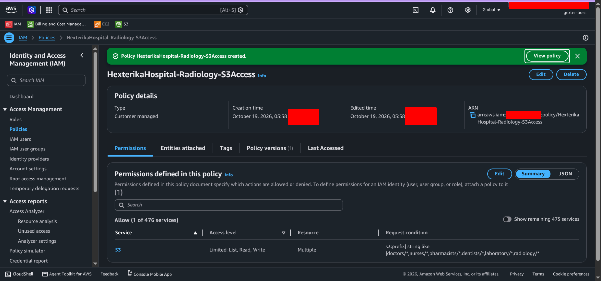

P1-S12 — Policy attached to `hexterika-radiology`

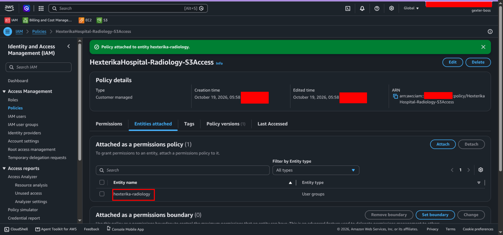

| Test ID | Action and purpose | Resource ARN | Expected | Actual result | Evidence |
| ------- | ------------------ | ------------ | -------- | ------------- | -------- |
| P1-T66 | `s3:GetObject` — Read doctors record | `arn:aws:s3:::hexterika-hospital-records/doctors/patient-001_doctors_diagnosis.json` | Allow | Allowed — PASS | [P1-T66.png](./images/P1-radiology/P1-T66.png) |
| P1-T67 | `s3:GetObject` — Read nurses record | `arn:aws:s3:::hexterika-hospital-records/nurses/patient-001_nurses_observation.json` | Allow | Allowed — PASS | [P1-T67.png](./images/P1-radiology/P1-T67.png) |
| P1-T68 | `s3:GetObject` — Read pharmacists record | `arn:aws:s3:::hexterika-hospital-records/pharmacists/patient-001_pharmacists_medication.json` | Allow | Allowed — PASS | [P1-T68.png](./images/P1-radiology/P1-T68.png) |
| P1-T69 | `s3:GetObject` — Read dentists record | `arn:aws:s3:::hexterika-hospital-records/dentists/patient-001_dentists_dental-exam.json` | Allow | Allowed — PASS | [P1-T69.png](./images/P1-radiology/P1-T69.png) |
| P1-T70 | `s3:GetObject` — Read laboratory record | `arn:aws:s3:::hexterika-hospital-records/laboratory/patient-001_laboratory_blood-test.json` | Allow | Allowed — PASS | [P1-T70.png](./images/P1-radiology/P1-T70.png) |
| P1-T71 | `s3:GetObject` — Read radiology record | `arn:aws:s3:::hexterika-hospital-records/radiology/patient-001_radiology_xray-report.json` | Allow | Allowed — PASS | [P1-T71.png](./images/P1-radiology/P1-T71.png) |
| P1-T72 | `s3:GetObject` — Read administrative record | `arn:aws:s3:::hexterika-hospital-records/administrative/patient-001_administrative_registration.json` | Deny | Denied — PASS | [P1-T72.png](./images/P1-radiology/P1-T72.png) |
| P1-T73 | `s3:PutObject` — Create or overwrite radiology test record | `arn:aws:s3:::hexterika-hospital-records/radiology/p1-test-radiology-record.json` | Allow | Allowed — PASS | [P1-T73.png](./images/P1-radiology/P1-T73.png) |
| P1-T74 | `s3:PutObject` — Write to doctors records | `arn:aws:s3:::hexterika-hospital-records/doctors/p1-test-radiology-record.json` | Deny | Denied — PASS | [P1-T74.png](./images/P1-radiology/P1-T74.png) |
| P1-T75 | `s3:PutObject` — Write to administrative records | `arn:aws:s3:::hexterika-hospital-records/administrative/p1-test-radiology-record.json` | Deny | Denied — PASS | [P1-T75.png](./images/P1-radiology/P1-T75.png) |
| P1-T76 | `s3:DeleteObject` — Delete radiology test record | `arn:aws:s3:::hexterika-hospital-records/radiology/p1-test-radiology-record.json` | Deny | Denied — PASS | [P1-T76.png](./images/P1-radiology/P1-T76.png) |
| P1-T77 | `s3:ListBucket` — List radiology prefix (request context `s3:prefix` = `radiology/*`) | `arn:aws:s3:::hexterika-hospital-records` | Allow | Allowed — PASS | [P1-T77.png](./images/P1-radiology/P1-T77.png) |
| P1-T78 | `s3:ListBucket` — List administrative prefix (request context `s3:prefix` = `administrative/*`) | `arn:aws:s3:::hexterika-hospital-records` | Deny | Denied — PASS | [P1-T78.png](./images/P1-radiology/P1-T78.png) |

### Patient Registration — P1-T79 to P1-T90

- Test identity: `hexterika-patient-registration` (IAM group)
- Policy: [`HexterikaHospital-PatientRegistration-S3Access`](./policies/HexterikaHospital-PatientRegistration-S3Access.json)

P1-S13 — Patient Registration policy created; permissions summary

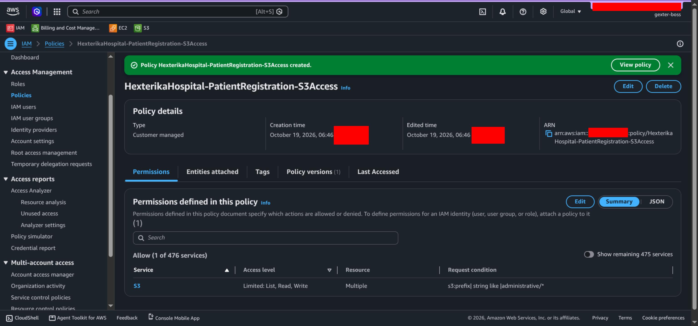

P1-S14 — Policy attached to `hexterika-patient-registration`

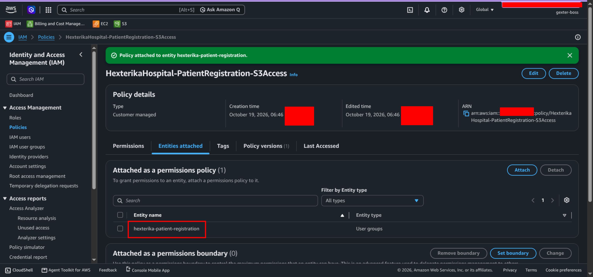

| Test ID | Action and purpose | Resource ARN | Expected | Actual result | Evidence |
| ------- | ------------------ | ------------ | -------- | ------------- | -------- |
| P1-T79 | `s3:GetObject` — Read administrative record | `arn:aws:s3:::hexterika-hospital-records/administrative/patient-001_administrative_registration.json` | Allow | Allowed — PASS | [P1-T79.png](./images/P1-patient-registration/P1-T79.png) |
| P1-T80 | `s3:GetObject` — Read doctors record | `arn:aws:s3:::hexterika-hospital-records/doctors/patient-001_doctors_diagnosis.json` | Deny | Denied — PASS | [P1-T80.png](./images/P1-patient-registration/P1-T80.png) |
| P1-T81 | `s3:GetObject` — Read nurses record | `arn:aws:s3:::hexterika-hospital-records/nurses/patient-001_nurses_observation.json` | Deny | Denied — PASS | [P1-T81.png](./images/P1-patient-registration/P1-T81.png) |
| P1-T82 | `s3:GetObject` — Read pharmacists record | `arn:aws:s3:::hexterika-hospital-records/pharmacists/patient-001_pharmacists_medication.json` | Deny | Denied — PASS | [P1-T82.png](./images/P1-patient-registration/P1-T82.png) |
| P1-T83 | `s3:GetObject` — Read dentists record | `arn:aws:s3:::hexterika-hospital-records/dentists/patient-001_dentists_dental-exam.json` | Deny | Denied — PASS | [P1-T83.png](./images/P1-patient-registration/P1-T83.png) |
| P1-T84 | `s3:GetObject` — Read laboratory record | `arn:aws:s3:::hexterika-hospital-records/laboratory/patient-001_laboratory_blood-test.json` | Deny | Denied — PASS | [P1-T84.png](./images/P1-patient-registration/P1-T84.png) |
| P1-T85 | `s3:GetObject` — Read radiology record | `arn:aws:s3:::hexterika-hospital-records/radiology/patient-001_radiology_xray-report.json` | Deny | Denied — PASS | [P1-T85.png](./images/P1-patient-registration/P1-T85.png) |
| P1-T86 | `s3:PutObject` — Create or overwrite administrative test record | `arn:aws:s3:::hexterika-hospital-records/administrative/p1-test-registration.json` | Allow | Allowed — PASS | [P1-T86.png](./images/P1-patient-registration/P1-T86.png) |
| P1-T87 | `s3:PutObject` — Write to doctors records | `arn:aws:s3:::hexterika-hospital-records/doctors/p1-test-registration.json` | Deny | Denied — PASS | [P1-T87.png](./images/P1-patient-registration/P1-T87.png) |
| P1-T88 | `s3:DeleteObject` — Delete administrative test record | `arn:aws:s3:::hexterika-hospital-records/administrative/p1-test-registration.json` | Deny | Denied — PASS | [P1-T88.png](./images/P1-patient-registration/P1-T88.png) |
| P1-T89 | `s3:ListBucket` — List administrative prefix (request context `s3:prefix` = `administrative/*`) | `arn:aws:s3:::hexterika-hospital-records` | Allow | Allowed — PASS | [P1-T89.png](./images/P1-patient-registration/P1-T89.png) |
| P1-T90 | `s3:ListBucket` — List doctors prefix (request context `s3:prefix` = `doctors/*`) | `arn:aws:s3:::hexterika-hospital-records` | Deny | Denied — PASS | [P1-T90.png](./images/P1-patient-registration/P1-T90.png) |
## Phase 1 Results

| Group | Tests | Expected Allow | Expected Deny | PASS |
| ----- | ----- | -------------- | ------------- | ---- |
| `hexterika-doctors` | 13 | 8 | 5 | 13 |
| `hexterika-nurses` | 13 | 8 | 5 | 13 |
| `hexterika-pharmacists` | 13 | 8 | 5 | 13 |
| `hexterika-dentists` | 13 | 8 | 5 | 13 |
| `hexterika-laboratory` | 13 | 8 | 5 | 13 |
| `hexterika-radiology` | 13 | 8 | 5 | 13 |
| `hexterika-patient-registration` | 12 | 3 | 9 | 12 |
| Total | 90 | 51 | 39 | 90 |

Every simulated result matched its expected result.

## Phase 1 Limitations

> **REVIEW:** Read each limitation and make sure you can explain it if asked.

- Results are policy-authorization evidence from the Policy Simulator, not live S3 operations.
- Access boundaries are department-level. Any member of a clinical group can read every patient's clinical records; there is no patient-level or care-relationship restriction.
- `s3:PutObject` allows overwriting existing records. Without versioning, an overwrite removes the previous content.
- A department can write a record under any patient identifier, including one with no administrative record, because S3 does not enforce relationships between objects.
- S3 is a simplified representation of hospital record storage. Hospital-specific rules would normally be enforced by an application.

## Phase 1 Conclusion

> **REVIEW:** Recruiters read this first. Check it says what you would say about the lab.

Phase 1 implemented department-level access control for a fictional hospital's patient records in one S3 bucket. Seven customer-managed IAM policies, one per department group, give each clinical department read access to all clinical records and write access to its own prefix only, give patient registration read and write access to administrative records only, and give no group delete access.

The 90 Policy Simulator tests show that each group policy allows exactly the reads, writes, and listings its hospital task requires, and denies administrative access to clinical groups, clinical access to registration, cross-department writes, deletion, and listing outside the permitted prefixes. Every denial comes from the absence of an allow, which leaves room for the conditional verifier access in Phase 2 without weakening the department policies.

Outside Phase 1: the duplicate-record workflow, the merge function and review flag, hospital IT permissions, versioning and deletion behavior, and live S3 operations as hospital users.
